<p align="center">
  
</p>

<p align="center">
  <a href="#quick-start"></a>
  
  
  
  
  
  <a href="LICENSE"></a>
</p>

<p align="center">
  <b>Agent skills that let Claude Code build, test and debug Meta Quest apps without putting on the headset.</b><br>
  Unity Play Mode on the Meta XR Simulator, driven through the Meta XR Operator · Meta's Horizon OS MCP for docs, devices and traces ·<br>
  headless builds with gates and a scripted device readout · a headless Blender pipeline for VR-ready assets.
</p>

<p align="center">
  <a href="#quick-start">Quick start</a> ·
  <a href="#the-skills">The skills</a> ·
  <a href="#how-the-loop-works">How the loop works</a> ·
  <a href="#showcase-a-truebeam-treatment-room-in-vr">Showcase</a> ·
  <a href="docs/CASE_STUDY.md">Case study</a> ·
  <a href="#repository-layout">Layout</a>
</p>

---

## Why

A screenshot of a VR scene can't tell **"the button did nothing"** from **"the ray wasn't on the
button"**. A headset round trip (build, sideload, put it on, look) costs about four minutes and
needs a person wearing it. So these skills replace *looking* with *asking*:

1. **Ask** the running app for its state, through tools the app registers for the agent.
2. **Act** through the real input path: simulated head, Touch controllers, buttons.
3. **Ask again**, compare, and pin the finding with a headless gate that fails without the fix.

The headset is kept for what only real hardware can answer: real hands, the Adreno GPU, the
compositor, thermals and performance.

<table>
  <tr>
    <td align="center" width="25%"><h3>~4 min → seconds</h3><sub>per check: headset round trip vs a simulator ask → act → ask</sub></td>
    <td align="center" width="25%"><h3>57 scenario suites</h3><sub>JSON L1 suites that assert on app state, run after every change</sub></td>
    <td align="center" width="25%"><h3>71 build gates</h3><sub>a failing gate refuses the APK before a 20-minute build</sub></td>
    <td align="center" width="25%"><h3>SSIM 0.90 · ΔE 3.7</h3><sub>the Unity room vs its Blender Cycles reference, same cameras</sub></td>
  </tr>
</table>
<sub>Numbers from the DicomSegVR Quest app, where this workflow was developed (October 2026).</sub>

## Showcase: a TrueBeam treatment room in VR

The radiotherapy mode of [DicomSegVR](https://dicomsegvr.com) switches from passthrough AR into a
virtual linac vault, with the machine moving as the treatment plan says. The room was generated
by headless Blender stages, checked against its Cycles reference inside Unity, and its
interactions (machine panel, collision warning, teleport, lasers) were developed and regression-tested
in the Meta XR Simulator before anyone put on a headset.

<table>
  <tr>
    <td colspan="2">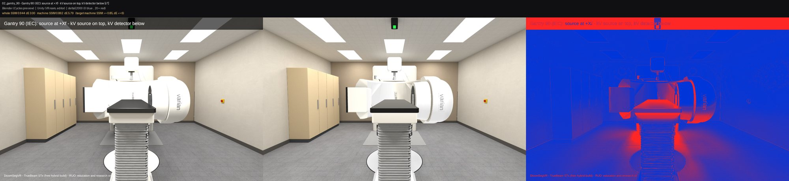</td>
  </tr>
  <tr>
    <td colspan="2" align="center"><sub><b>Blender Cycles reference · Unity (VR room, editor) · ΔE2000 heat map.</b> The same camera, scored automatically: whole-frame SSIM 0.94, machine SSIM 0.86, ΔE 5.8 on this shot.</sub></td>
  </tr>
  <tr>
    <td width="50%">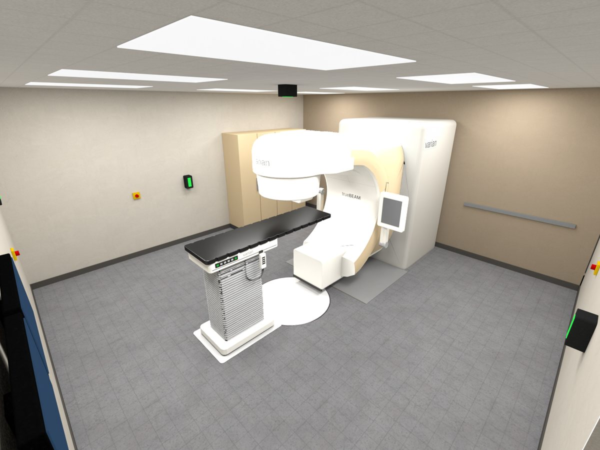</td>
    <td width="50%">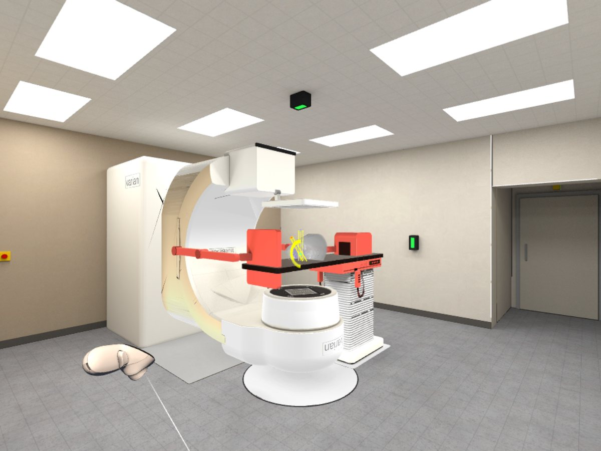</td>
  </tr>
  <tr>
    <td align="center"><sub><b>Headless Blender</b> · the generated 6.2 × 6.2 m vault, Cycles preview</sub></td>
    <td align="center"><sub><b>XR Simulator</b> · the mesh-accurate collision warning, asserted by a scenario</sub></td>
  </tr>
  <tr>
    <td width="50%">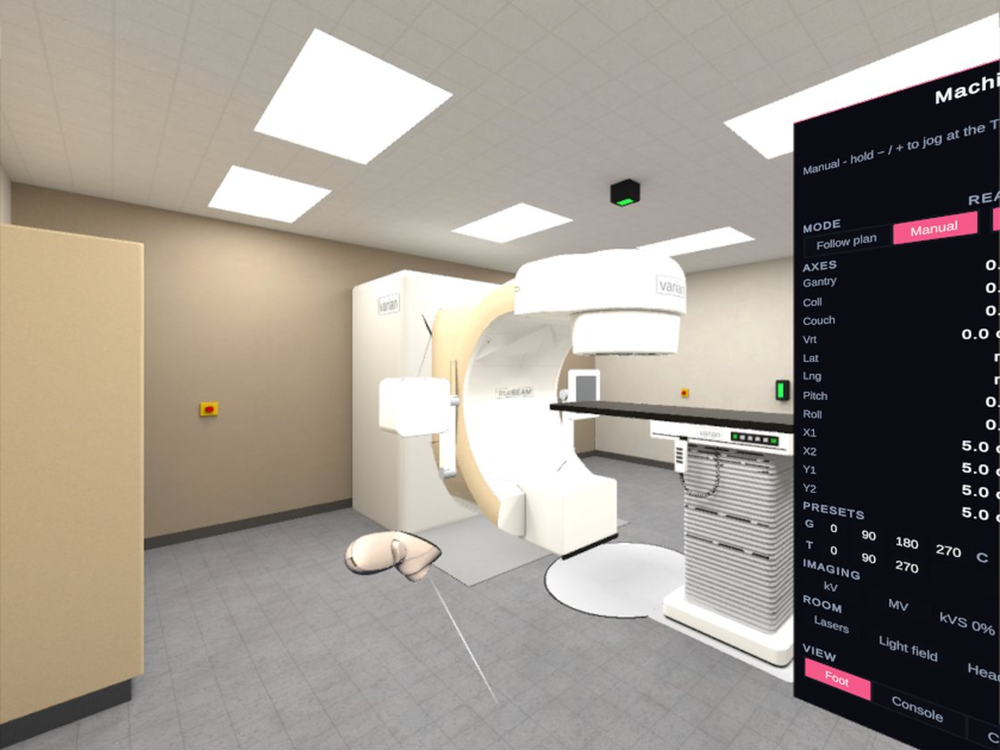</td>
    <td width="50%">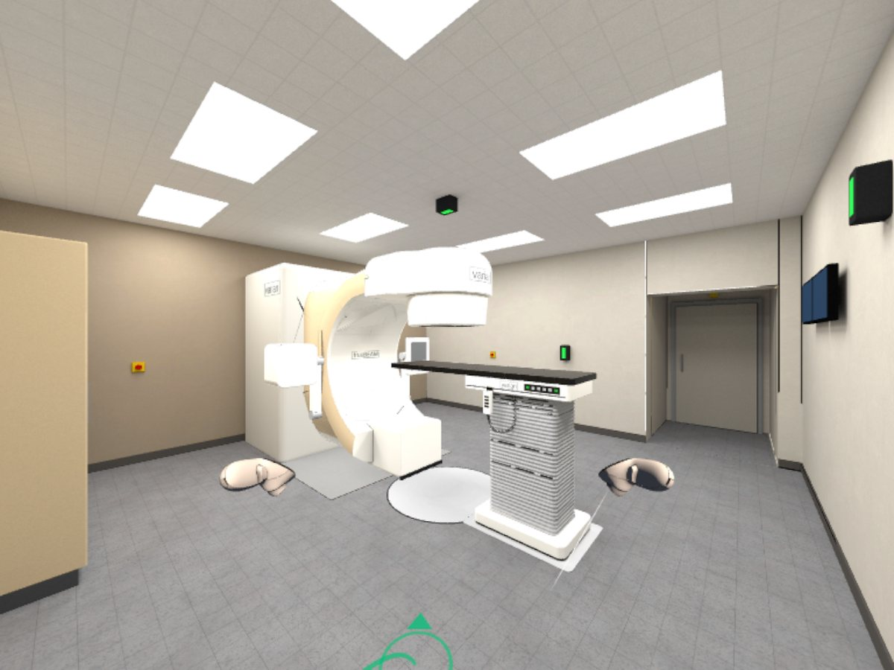</td>
  </tr>
  <tr>
    <td align="center"><sub><b>Composited eye capture</b> · compositor-layer panel over the room</sub></td>
    <td align="center"><sub><b>Simulated Touch controllers</b> · teleport, verified by app state</sub></td>
  </tr>
</table>

> [!NOTE]
> DicomSegVR is for research and education only; it is not a medical device. The room is a free
> hybrid model built for the app; TrueBeam and Varian are trademarks of Varian Medical Systems, a
> Siemens Healthineers company, and nothing here implies their endorsement. The app's source is not
> part of this repo; the skills and templates are.

## How the loop works

<p align="center"></p>

One check, as the agent actually runs it: click a button **through the controller ray** and prove
it with state, not with a picture.

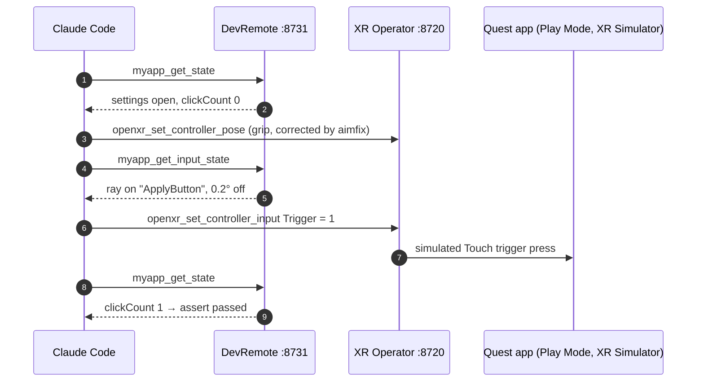

If the click works when the app invokes the button directly but not through the ray, the bug is in
the aim, the raycast or the event path; if it fails both ways, it's the handler. That one
comparison ends most "the button is dead" investigations.

### Four loops, cheapest first

<p align="center"></p>

## The skills

<p align="center"></p>

| skill | use it when | what's inside |
|---|---|---|
| [**unity-quest-sim-loop**](skills/unity-quest-sim-loop/SKILL.md) | verifying, testing or reproducing anything in a Unity Quest app; "it's broken in the headset" | `op.py` (one client for the Operator + the app's tools), `run_scenario.py` (JSON suites: wait / assert / aim / capture / composite), `aimfix.py`, `panelshot.py`, `imgdiff.py` (prove one object's colour), `reload.py`, `quickcheck.ps1` (Roslyn, no project lock), `editor-play.ps1`, `adbtools.py`; C# templates for DevXr, DevRemote, AgentTools, the Operator bridge and an adb command channel; references on setup, the Operator, the device and the pitfalls |
| [**horizon-os-mcp**](skills/horizon-os-mcp/SKILL.md) | any Meta SDK name, manifest entry or Store rule; device control; crashes, stutter, heat | connection guide (npx `metavr` vs the MQDH bundle), `mcp_probe.py` (version, tools, a timed docs query), the docs-first rule, device and UI tools, a Perfetto + VrApi performance playbook |
| [**quest-build-deploy**](skills/quest-build-deploy/SKILL.md) | build, deploy, sideload, "test it on the device" | `QuestBuild.cs` (CLI entry points + `[QuestBuildGate]` gates that refuse the build), `unity_build.ps1` (waits on the Unity process, never on a guessed log line), `quest_deploy.py` (install, launch, crash check, worn-headset readout with a VrApi summary) |
| [**blender-cli-vr-assets**](skills/blender-cli-vr-assets/SKILL.md) | generating or fixing 3D assets for Unity/Quest with headless Blender | one process per stage, a validate gate bound to the stage's sha256, deterministic FBX export, baked atlases for Quest, Cycles previews as the fidelity reference, an SSIM/ΔE scorer, and a runnable example pipeline |

Each skill is a folder with a `SKILL.md` (what Claude reads first), `scripts/`, `references/` and
`assets/`. They work alone and better together; the toolchain above is how they hand off.

## Quick start

### 1. Install the plugin

In Claude Code:

```text
/plugin marketplace add gomesgustavoo/vr-dev-skills
/plugin install vr-dev@vr-dev-skills
```

Recommended alongside it: Meta's own plugin, which brings the Horizon OS MCP server and Meta's
`hz-*` skills.

```text
/plugin marketplace add meta-quest/agentic-tools
/plugin install meta-vr@meta-quest
```

<details>
<summary><b>Prefer plain skill folders?</b> Copy them into <code>~/.claude/skills</code></summary>

```bash
git clone https://github.com/gomesgustavoo/vr-dev-skills
cd vr-dev-skills
./tools/install.sh                      # macOS / Linux / Git Bash
powershell -File tools\install.ps1      # Windows PowerShell
```
Copied skills are invoked without the plugin prefix (`/unity-quest-sim-loop`) and don't update
with the marketplace.
</details>

### 2. Set up the machine (once)

| what | how |
|---|---|
| Meta XR Simulator | `npx -y metavr tools install xrsim` |
| Meta XR Operator proxy + layer | copy them out of any Meta XR Core SDK 205+ package: [setup.md](skills/unity-quest-sim-loop/references/setup.md#machine-once) (works for SDK 203 projects too) |
| Horizon OS MCP | `claude mcp add --scope user metavr -- npx -y metavr mcp server` (or Meta's plugin above), then `python skills/horizon-os-mcp/scripts/mcp_probe.py` |
| Python 3.10+, Node 18+, adb | adb from Android platform-tools or the Unity Android module |
| Blender (for assets) | a portable Blender 4.2+ LTS; point `BLENDER` at its executable |

The [`mcp/`](mcp/README.md) folder has a ready `.mcp.json` for a Unity project (Horizon OS MCP +
the Operator, no personal paths).

### 3. Set up a project (once)

Ask Claude in your Unity project:

```text
Set up the simulator loop in this project.
```

It follows [setup.md](skills/unity-quest-sim-loop/references/setup.md): copies the DevXr / DevRemote /
AgentTools templates with your namespace, scene and tool prefix, compiles them with the lock-free
check, starts Play Mode on the simulator and proves the tools answer. Then the important part, the
app's own tools: one that returns the real state, and one per thing the agent must do without a
hand. Paste [`templates/CLAUDE.quest.md`](templates/CLAUDE.quest.md) into your project's `CLAUDE.md`
so every session knows the loops.

### 4. Things to ask

```text
Verify the Settings panel's Apply button works through the controller ray, in the simulator.
The selection highlight is invisible on the headset. Find out why without me putting it on.
Turn that check into a scenario and add it to the suite.
Is OVRComprehensiveInteractionRig the right rig for SDK 205? Check Meta's docs.
Build a dev APK, sideload it, and give me a 3-minute readout while I test the menu.
Capture a Perfetto trace of the 3D view and compare it with yesterday's baseline.
Build a test room in headless Blender, bake it, export it for Unity and score Unity against the Cycles render.
```

## The Blender pipeline

<p align="center">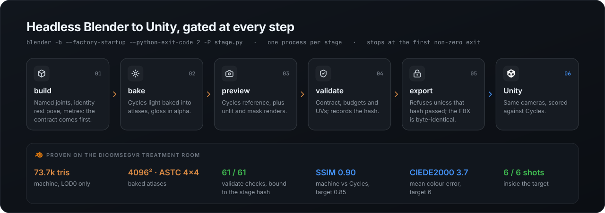</p>

The rules that made the generated room trustworthy:

- **One Blender process per stage**, `blender -b --factory-startup --python-exit-code 2 -P stage.py`,
  with the `.blend` handed from stage to stage. A failed stage stops the run with its exit code.
- **The contract first**: one authoring frame, joints addressed by name with identity rest
  rotations, and exactly one axis conversion, in the export.
- **Export refuses** unless `validate.json` passed on the exact stage file it exports (sha256), and
  the FBX is byte-identical on a rerun (timestamps, paths and Python's randomised hashes pinned).
- **Bake for the Quest**: the full Cycles light goes into atlases drawn by cheap shaders; the
  Cycles previews are the reference Unity is scored against (SSIM + CIEDE2000, same cameras).

Try the method in about 25 seconds with the bundled example (a room and a jointed machine):

```bash
export BLENDER=/path/to/blender          # PowerShell: $env:BLENDER = "C:\path\to\blender.exe"
export PIPELINE_PY=/path/to/python       # a Python with numpy, scikit-image, Pillow (fidelity stage only)
cd skills/blender-cli-vr-assets/examples/hello-room
python ../../scripts/run_stages.py       # add --quick to iterate in ~13 s
```

<p align="center">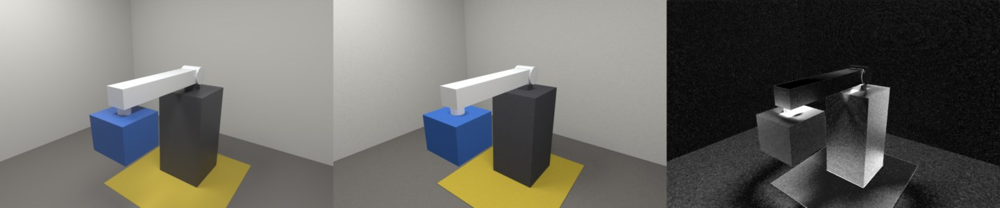</p>
<p align="center"><sub><b>examples/hello-room, full quality, 22.9 s on Blender 5.2.2:</b> Cycles reference · the baked atlas drawn unlit (what the Quest draws) · ΔE2000 heat.
Machine SSIM 0.94, ΔE 3.8, 19 / 19 validate checks, and the same FBX sha256 on every rerun.</sub></p>

## Repository layout

```text
vr-dev-skills/
├── .claude-plugin/          plugin.json + marketplace.json (this repo is its own marketplace)
├── skills/
│   ├── unity-quest-sim-loop/    SKILL.md · scripts/ · assets/ (C# templates, scenarios) · references/ · evals/
│   ├── horizon-os-mcp/          SKILL.md · scripts/mcp_probe.py · references/perf-playbook.md
│   ├── quest-build-deploy/      SKILL.md · scripts/ (unity_build.ps1, quest_deploy.py) · assets/QuestBuild.cs
│   └── blender-cli-vr-assets/   SKILL.md · scripts/ · references/ · examples/hello-room/
├── mcp/                     .mcp.json for a Unity project + connection notes
├── templates/               CLAUDE.md section for a Quest project
├── docs/                    diagrams, showcase images, the case study
└── tools/                   install scripts, check_repo.py (secrets / personal data / skill lint)
```

## Requirements and compatibility

- **Claude Code** (CLI, desktop or IDE). The skills are plain Markdown + scripts, so other agents
  that read `SKILL.md` folders can use them too.
- **Unity 6** with Android Build Support, **Meta XR SDK 203 or 205+** (all-in-one or Core), OpenXR.
  Templates cover both the Assembly-CSharp layout and asmdefs.
- **Windows** for the editor-side scripts (PowerShell 5.1); the Python tools also run on macOS and
  Linux. The Meta XR Simulator and Operator are Meta's; install them from Meta.
- **Quest 3 / 3S** for L2. Developer mode and a USB cable (or Wi-Fi adb).

## Safety and hygiene

- No credentials, tokens, device serials, internal hosts or personal paths are in this repo;
  [`tools/check_repo.py`](tools/check_repo.py) checks for them (and for skill lint) locally and in CI,
  with a git-ignored `.private-terms` list for your own names.
- The skills tell the agent to **ask before** anything that changes the user's world: killing an
  open editor, uninstalling an app (it deletes its data), re-signing an APK, changing device
  settings, pushing or publishing.
- Dev-only code (agent tools, DevRemote, the command channel) is guarded by
  `#if UNITY_EDITOR || DEVELOPMENT_BUILD` and never ships in a release build; the lock-free check
  compiles the player's defines to prove it.

## Credits

Built by [Gustavo Formento](https://github.com/gomesgustavoo) while developing DicomSegVR, with
Claude Code. The Meta XR Simulator, the Meta XR Operator, `metavr` / `hzos-dev-mcp` and Meta's
`agentic-tools` skills are Meta's; this repo contains no Meta binaries and links to Meta's own
distribution. Meta, Meta Quest and Horizon OS are trademarks of Meta Platforms, Inc.; Unity is a
trademark of Unity Technologies; Blender is a trademark of the Blender Foundation.

Released under the [MIT license](LICENSE).
