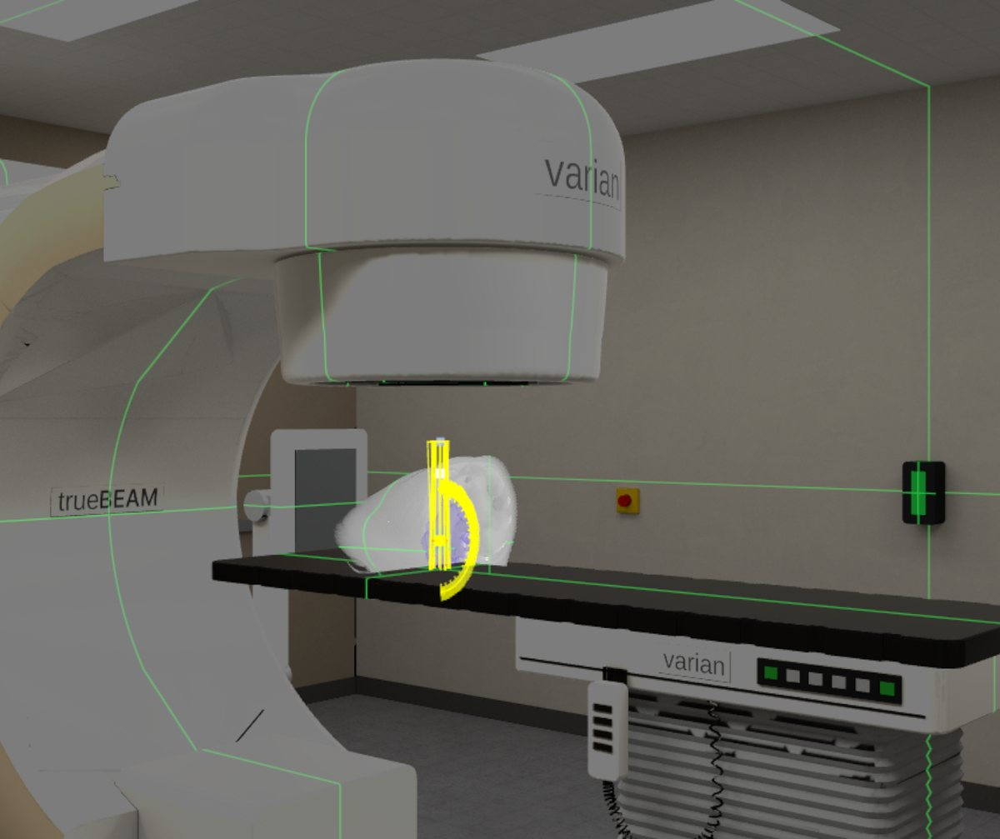

# Case study: the TrueBeam room in DicomSegVR

How a Quest app gained a full VR radiotherapy treatment room in October 2026, built and tested
mostly without a headset, with Claude Code running the four skills in this repo.

## The starting point

[DicomSegVR](https://dicomsegvr.com) is a Meta Quest 3 / 3S viewer for AI-segmented CT and MR
studies: passthrough AR, a raymarched 3D volume, per-structure meshes, and a radiotherapy mode with
beams, dose, isodose surfaces and DVHs. The app is Unity 6 + URP on **Meta XR SDK 203**, so it has
no built-in Meta XR Operator; the loop was set up without an SDK upgrade by loading the Operator
layer by environment variable and serving the app's own tools over DevRemote
([setup.md](../skills/unity-quest-sim-loop/references/setup.md)).

The loop had already earned its place on an earlier app: a reversed-Z skybox was painting over
every opaque object, three headset rounds of "the controllers have no texture" had missed it, and
one `debug_renderers` query in the simulator found it.

The goal: a switch from AR passthrough into a VR treatment vault with a jointed linac whose
gantry, collimator and couch follow the loaded plan, with manual jogging, a machine console, and
nothing in the shipped AR mode allowed to change.

## How it ran

The work went in **waves**: a lead agent planned, then sub-agents ran independent tracks in
parallel (Blender in one, Unity in another), each ending with its own checks, then a review agent
looked for bugs, then a fix run, then the headset.

| wave | track | what happened | verified by |
|---|---|---|---|
| R1 / R2 | Unity ∥ Blender | the AR ↔ VR switch with a placeholder room, while headless Blender built a free hybrid TrueBeam from public geometry + CC0 textures | L1 scenarios; Blender `validate.py` |
| L2-A | headset spike | is the passthrough clock cap live? Yes: re-evaluated at runtime. But under GPU saturation the GPU reached the same 640 MHz in AR and VR, so VR bought no GPU clock; the real gains were CPU +19 % and compositor 1.17 → 0.56 ms | VrApi logcat on a Quest 3S, `quest_deploy.py readout` |
| R4 | Unity | machine kinematics in IEC 61217 signs, angles solved from the plan's control points | gates against golden values generated by the server's Python converter |
| R3 / R5 | Unity | the real room, the Machine panel, QA visuals (lasers, light field, collision) | L1 scenarios + composited eye captures |
| L2-B | headset | store-style check: 549 s scored, 0.2 % of seconds under 60 fps; AR 73 fps at 9.1 ms App GPU; VR room 1.5–3.6 ms App GPU | VrApi summary |
| fidelity | Blender ∥ Unity | the Cycles previews looked right and Unity looked flat, so the full Cycles light was baked display-referred into the atlases and Unity was scored against the previews: machine SSIM **0.784 → 0.903**, ΔE **10.1 → 3.8**, 6 / 6 shots on target | `fidelity.py` on Unity frames rendered from the exported `cameras.json` |
| wave 8 | Blender ∥ Unity | review feedback: parts touching the couch, low resolution at distance, no free locomotion | see below |

### Wave 8, in detail

- **Clearance (Blender).** A mesh-accurate sweep posed the rig exactly as Unity's kinematics do and
  measured every part pair on the triangles. The parts "touching the couch" were the imaging arm's
  linear joint-angle path swinging the panel through the couch top; a waypoint path fixed it. The
  same sweep now ships as a JSON fixture that a Unity gate replays.
- **Detail (Blender).** The machine went from 28k to 73.7k triangles, LOD0 only, with 4096² atlases at
  ASTC 4x4, because the VR room had GPU headroom the AR volume never had.
- **Teleport (Unity).** The non-dominant stick follows its ray: aim, release to land, flick to snap
  turn; landings judged against a floor occupancy grid baked from the room. Developed in the
  simulator against one scenario of 183 steps and 79 waits / asserts, from the stick to the landing pose.
- **VR quality profile (Unity).** The eye buffer allocated once at scale 1.0 with MSAA 4x for the
  room, and the raymarched volume drawn at its proven 0.6 through `renderViewportScale`, so switching
  costs no reallocation and no blink.
- **A stale-frame hunt.** VR showed stale frames at low load. The cause: the Machine panel re-laid
  out its text while the machine moved. Fixed slots, and a gate that checks all 33 written labels.
- **Review.** 12 findings, 11 fixed; one (an imaging panel's stow position inside the gantry shell)
  recorded as a geometry fix for the next model.

End state: **71 / 71 build gates**, the room at machine SSIM 0.898 / ΔE 3.72 against its Cycles
reference (6 / 6 shots), and 57 scenario files as the regression net.

## What made it work

1. **The app reports on itself.** Every time a check would have guessed state from a picture, a
   tool was added that returns it (`dsvr_env`, `dsvr_get_input_state`, `dsvr_debug_renderers`...).
   Every time the agent had no hand, a tool was added that acts through the same entry point the
   hand uses.
2. **Assertions, not screenshots.** 57 scenario files, each step with a symptom written as the user
   would see it, none able to pass vacuously.
3. **Gates that have been seen failing.** A gate is reverted against once with the bug restored
   before it counts. Gate messages describe the headset symptom.
4. **The docs, not memory.** Meta SDK names and settings were checked against the Horizon OS MCP
   (`vr_docs_search`, `vr_api_search`) before code was written against them.
5. **Blender as a build step, not an art tool.** Pinned version, one process per stage, a
   validate gate bound to the stage's hash, a deterministic FBX, and the Cycles render as the
   measurable target for Unity.
6. **The headset for what only it can answer.** Clock behaviour, real hands, the Adreno GPU, and the
   final look were the only headset sessions, each with a scripted readout instead of a description.

## Reproduce the approach

- Simulator loop: [`skills/unity-quest-sim-loop`](../skills/unity-quest-sim-loop/SKILL.md)
- Docs, device, traces: [`skills/horizon-os-mcp`](../skills/horizon-os-mcp/SKILL.md)
- Builds, sideload, readouts: [`skills/quest-build-deploy`](../skills/quest-build-deploy/SKILL.md)
- Generated assets: [`skills/blender-cli-vr-assets`](../skills/blender-cli-vr-assets/SKILL.md)

DicomSegVR is research and education software, not a medical device. TrueBeam and Varian are
trademarks of Varian Medical Systems; the room is an independent hybrid model and implies no
endorsement.
